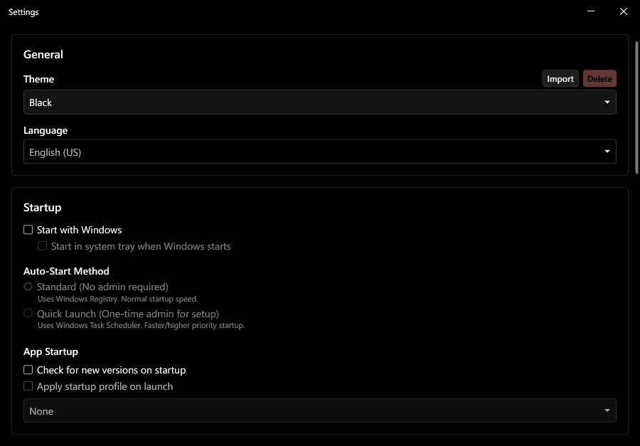

# Settings

Open Settings from the **"Settings"** button in the main window or in the system tray menu.

---

## Theme

Select a theme from the dropdown. The change applies immediately.

The built-in theme options are **Light**, **Dark**, **Black**, and **System**. System follows the Windows light/dark setting, and the packaged visual themes use the Windows accent color.

> See [Themes](./themes.md) for custom theme files and DPM Theme Builder.

---

## Start with Windows

Enable **"Start with Windows"** to launch Display Profile Manager automatically when you sign in. When enabled, **"Start in system tray when Windows starts"** becomes available.

**Auto-Start Method** offers two modes:

- **Standard (No admin required)** — uses the per-user Registry startup entry.
- **Quick Launch (One-time admin for setup)** — uses Task Scheduler and requires administrator approval during setup.

When an elevated Task Scheduler operation is canceled, Settings restores the previous auto-start state and shows a warning. Other failures show an error and restore the previous state.

---

## App Startup

Configure actions that occur when Display Profile Manager launches.

- **Check for new versions on startup** — off by default. When enabled, Display Profile Manager checks GitHub for a newer release immediately and at startup. Newer releases are shown in the status bar, About section, and Windows notifications after the three-day age threshold.
- **Apply startup profile on launch** — apply a selected profile when Display Profile Manager starts.

Update checking is not continuously polled. Display Profile Manager checks release metadata only; it does not download, install, or execute updates.

---

## Window Behavior

### Closing the app

- **"Minimize to system tray"** — keep Display Profile Manager running in the background.
- **"Exit application"** — shut Display Profile Manager down immediately.
- **"Remember my choice"** — suppress the close prompt and always use the selected behavior.

### Notifications

- **"Show notifications when profiles are applied"** — control tray/Windows notifications for supported profile-apply entry points.

### Integrations

- **"Add profile switcher to desktop right-click menu"** — register the native shell extension as a per-user integration. The extension applies profiles through the `--headless` command path.
- **"Manage Start Menu profile shortcuts"** — keep application-managed profile shortcuts synchronized in the Start Menu. Shortcut launches use stable profile identity, so renaming a profile does not break its managed shortcut.

---

## Display Recovery

Display recovery settings control what happens when a display-configuration stage fails. All three recovery settings are enabled by default.

- **Abort the profile application if display configuration fails** — stop the profile pipeline when a display stage fails instead of continuing through DPI, wallpaper, audio, and scripts.
- **Rollback after an aborted display application** — perform recovery after an aborted display apply.
- **Reapply the previous profile** — use the previously active profile when one exists; otherwise fall back to the pre-apply display snapshot.
- **Restore the pre-apply snapshot** — use the pre-apply snapshot directly. Snapshot rollback restores display state only and does not leave a profile marked active.

---

## Global Hotkeys

Quick Switch controls appear first in this Settings section:

- **"Enable Quick Switch profile switcher overlay"** — enable or disable the compact profile switcher overlay.
- **"Quick Switch hotkey"** — configure the global hotkey that opens Quick Switch.
- **"Use active monitor"** — enabled by default. When active-monitor targeting is enabled, **"Mouse position"** is the default source and **"Window focus"** is the alternate source. When **"Use active monitor"** is off, Quick Switch opens on the primary monitor. **"Mouse position"** and **"Window focus"** never fall back to each other; if the enabled active source cannot resolve a monitor, Quick Switch falls back only to the primary monitor.
- **"Configured Hotkeys"** — read-only list of configured profile hotkeys and their current enabled state. Edit a profile in the Profile Editor to add or change its hotkey.

---

## About

Shows the current application version, settings-file path, dependency metadata, and contributors.
